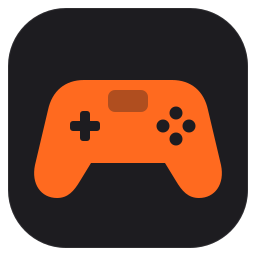
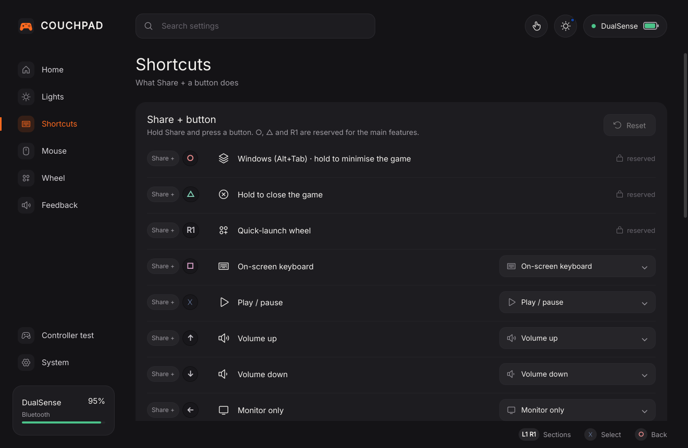
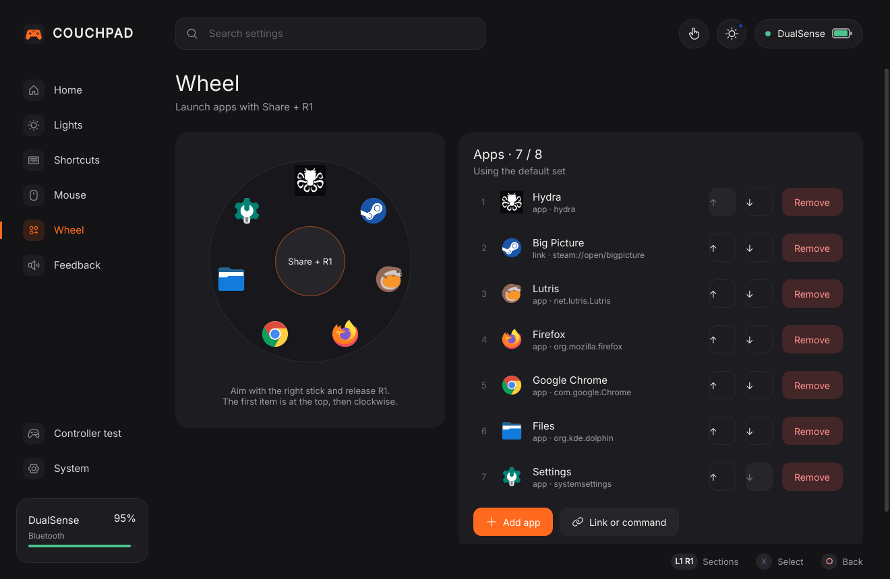
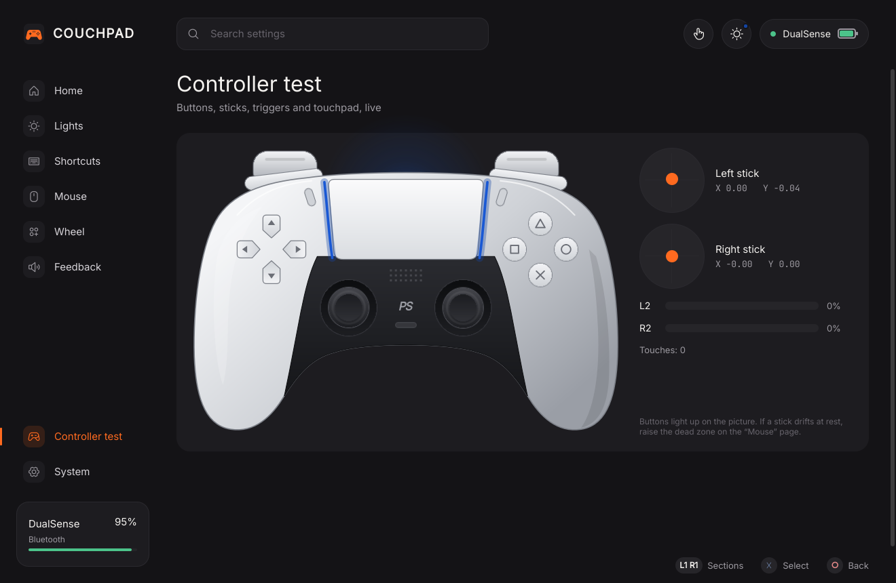
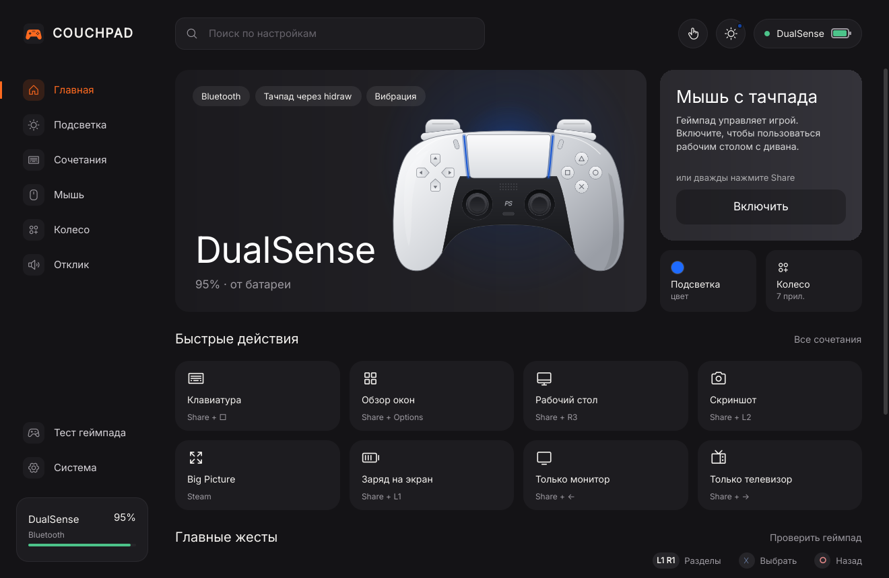
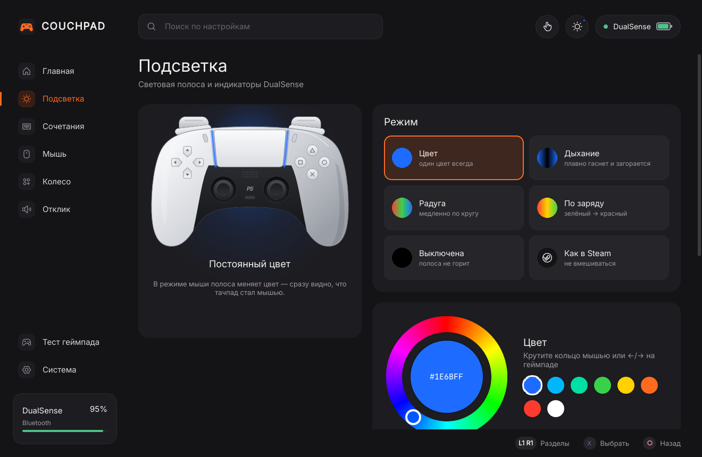

<p align="center"></p>

<h1 align="center">Couchpad</h1>

<p align="center"><b>Use your DualSense as a couch remote for a Linux PC.</b><br>
Gestures, touchpad mouse, live light bar, a quick-launch wheel and on-screen messages above any game.<br>
KDE Plasma 6 · Wayland · Bazzite / Fedora Atomic · Bluetooth or USB</p>

<p align="center"><a href="#русский">Русский</a> · <a href="https://github.com/shamilmusaev/couchpad/releases/latest">Download</a></p>


## Why

When a game runs full screen on the TV and you're on the couch, the keyboard
is far away. Couchpad turns the controller in your hands into everything else:

| Gesture | What it does |
|---|---|
| **Share ×2** | Touchpad becomes a mouse (and back) |
| **Share + ○** | Window switcher (Alt+Tab): D-pad / stick to move, ✕ to pick |
| **Share + ○, hold** | Minimise the game and get to the desktop |
| **Share + △, hold** | Force-close the game (the whole Steam game process tree) |
| **Share + R1** | Quick-launch wheel: aim with the right stick, release R1 |
| **Share + □** | Steam on-screen keyboard (kept on screen, mouse paused while open) |
| **Share + ↑ / ↓** | Volume, repeats while held |
| **Share + ← / →** | Monitor only / TV only (needs a `display-switcher` command) |
| **Share + L3** | Open the Couchpad window |

Every other **Share + button** is yours to remap: mute, mic, media keys,
screenshot, overview, show desktop, fullscreen, Big Picture, turn the pad off…

A progress ring on screen shows how long to keep holding; the controller
clicks and rumbles along.

## Highlights

- **Control center** with full gamepad navigation (D-pad, ✕, ○, L1/R1), a
  settings search and a tray icon showing battery and mouse mode.
- **Live DualSense**: the picture mirrors your real pad: buttons, sticks,
  triggers and touches.
- **Light bar**: solid colour, breathing, rainbow, battery colour, flashes on
  actions, a different colour in mouse mode; player LEDs can show battery.
- **Messages above games**: toasts and the hold ring are layer-shell overlays,
  so they show over fullscreen games without stealing focus.
- **Quick-launch wheel** with any apps, links or commands (up to 8).
- **Touchpad mouse done properly**: smoothing, acceleration, natural scroll,
  tap to click (1/2/3 fingers), click-drag, R2 / R1 as left / right click; sticks
  can move and scroll too, or stay out of it (the default).
- **Steam stays out of the way**: an optional neutral desktop layout stops
  Steam turning Share into Esc on the desktop; game layouts aren't touched.
- **Idle power-off**, low battery warnings, config hot reload, English and Russian.

| | |
|---|---|
|  |  |
|  |  |

## Install

Download `couchpad-<version>.tar.gz` from
[Releases](https://github.com/shamilmusaev/couchpad/releases/latest), then:

```sh
tar xf couchpad-*.tar.gz
cd couchpad-*/
./install.sh
```

No root needed. The installer copies Couchpad to `~/.local/share/couchpad`,
adds the app to the menu, starts the `couchpad` user service and the tray
icon. Steam closes for a few seconds while its desktop layout is made
neutral; skip that with `./install.sh --no-steam`.

Update: run the new release's `install.sh`. Remove: `./install.sh uninstall`.

**Requirements:** KDE Plasma 6 on Wayland, Python 3.11+, `python3-evdev`,
`python3-pyudev`, `python3-gobject`, `python3-pyside6` (all preinstalled on
Bazzite). The installer tells you what's missing.

## Command line

```sh
couchpad app                 # open the control center
couchpad status              # what the service sees (JSON)
couchpad mouse on|off|toggle
couchpad action <name>       # e.g. show_desktop, power_off
couchpad haptic demo         # feel the click patterns
couchpad steam-layout status|neutral|restore
journalctl --user -u couchpad -f
```

Settings live in `~/.config/couchpad/config.toml`; edits apply instantly.

## How it works

A small asyncio service reads the DualSense through evdev and hidraw (the
touchpad and the accelerometer come straight from the HID reports, so no udev
rule is needed on Bazzite), writes a virtual mouse/keyboard through uinput and
talks to KWin with short scripts over D-Bus. The light bar uses the kernel's
LED class device; player/mic LEDs use a minimal output report. The overlay and
the control center are PySide6 / Qt Quick.

Tests: `PYTHONPATH=.:tests python3 -m unittest discover -s tests`. A live
acceptance suite drives a virtual DualSense created through `/dev/uhid`:
`COUCHPAD_LIVE=1 PYTHONPATH=.:tests python3 -m unittest tests.test_live`.

## Releasing

```sh
# bump __version__ in couchpad/__init__.py and CHANGELOG.md, commit, then:
scripts/build-release.sh                       # dist/couchpad-<version>.tar.gz + .sha256
git tag -a v<version> -m "Couchpad <version>" && git push origin v<version>
gh release create v<version> dist/couchpad-<version>.tar.gz* --notes-file CHANGELOG.md
```

## Credits

- HD haptics over Bluetooth follow the protocol worked out by
  [SAxense](https://apps.sdore.me/SAxense) (MPL-2.0).
- [Inter](https://rsms.me/inter/) and [JetBrains Mono](https://www.jetbrains.com/lp/mono/) fonts (SIL OFL 1.1).
- [Phosphor](https://phosphoricons.com) icons (MIT).

Couchpad is MIT licensed. Not affiliated with Sony or Valve. DualSense and
PlayStation are trademarks of Sony Interactive Entertainment.


---

## Русский

**Couchpad превращает DualSense в пульт для ПК с дивана.** Жесты на кнопке
Share, мышь с тачпада, живая подсветка, колесо быстрого запуска и подсказки
поверх любой игры. KDE Plasma 6, Wayland, Bazzite, Bluetooth или USB.



| Жест | Действие |
|---|---|
| **Share ×2** | тачпад становится мышью (и обратно) |
| **Share + ○** | переключатель окон (Alt+Tab) |
| **Share + ○, удерживать** | свернуть игру, перейти на рабочий стол |
| **Share + △, удерживать** | принудительно закрыть игру |
| **Share + R1** | колесо быстрого запуска (правый стик, отпустить R1) |
| **Share + □** | экранная клавиатура Steam |
| **Share + ↑ / ↓** | громкость |
| **Share + ← / →** | только монитор / только телевизор |
| **Share + L3** | открыть окно Couchpad |

Остальные сочетания Share + кнопка можно переназначить в приложении.

**Установка:** скачайте архив из
[Releases](https://github.com/shamilmusaev/couchpad/releases/latest),
распакуйте и запустите `./install.sh`, root не нужен. Обновление: `install.sh`
из нового релиза. Удаление: `./install.sh uninstall`.

В приложении можно:
- настроить подсветку: цвет, дыхание, радугу, цвет по заряду, вспышки и отдельный цвет в режиме мыши;
- переназначить сочетания и задать время удержания;
- настроить скорость и сглаживание мыши и стиков;
- выбрать приложения для колеса;
- выбрать тип отклика: вибрация или HD-хаптика;
- проверить геймпад вживую;
- управлять службой, значком в трее, языком (русский или English) и выключением геймпада без дела.


